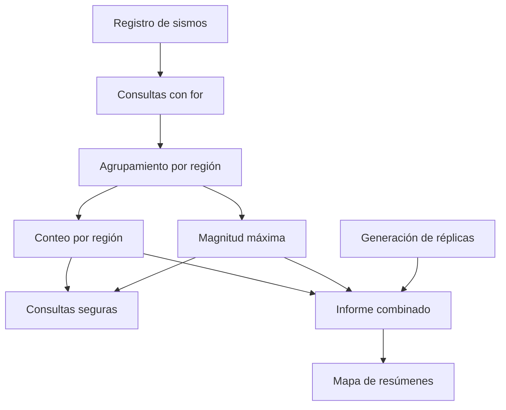
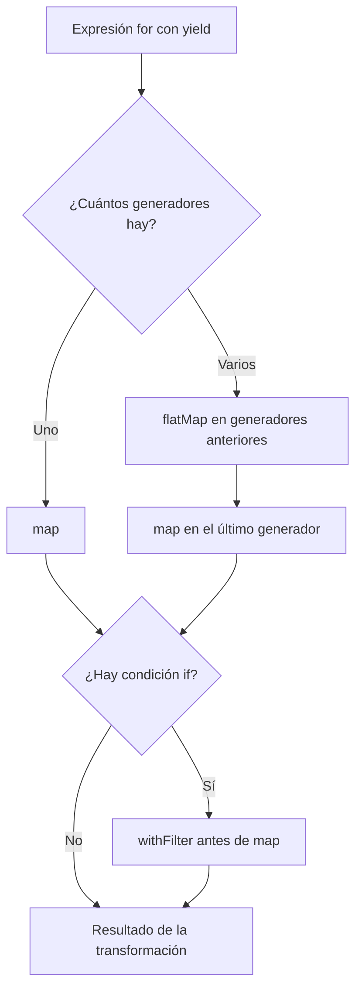
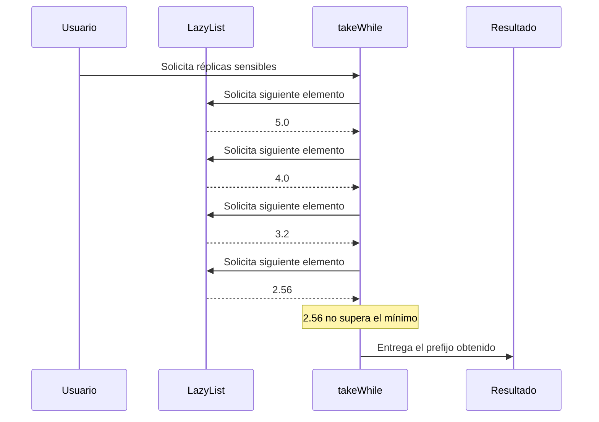

# Informe de proceso — Registro sísmico

## 1. Introducción

El objetivo de este taller es implementar consultas sobre un registro de sismos utilizando herramientas de programación funcional en Scala. Para ello se utilizan expresiones `for`, mapas, funciones de orden superior y secuencias perezosas.

El desarrollo se realizó procurando mantener la inmutabilidad de los datos, evitar efectos secundarios y expresar las operaciones mediante transformaciones de colecciones.

El informe explica el proceso seguido para construir las funciones, las operaciones en las que se traducen las expresiones `for`, el comportamiento de las consultas y la evaluación perezosa de las réplicas.

---

## 2. Contexto y modelo de datos

El taller proporciona los siguientes tipos de datos, que se conservan sin modificaciones:

```scala
case class Fecha(anio: Int, mes: Int)

case class Sismo(
                  fecha: Fecha,
                  region: String,
                  magnitud: Double,
                  profundidad: Int
                )

type Registro = List[Sismo]

case class Resumen(
                    sismos: Int,
                    maxima: Double,
                    replicas: Int
                  )
```

El registro está compuesto por una lista de sismos. Cada elemento contiene una fecha, una región, una magnitud y una profundidad.

Para realizar las trazas de las funciones se utiliza el registro de ejemplo proporcionado en el material:

```scala
val registro = List(
  Sismo(Fecha(2025, 3), "Valle",     4.2, 30),
  Sismo(Fecha(2025, 3), "Santander", 5.1, 150),
  Sismo(Fecha(2025, 4), "Valle",     3.8, 25),
  Sismo(Fecha(2025, 4), "Choco",     6.0, 40),
  Sismo(Fecha(2025, 5), "Santander", 4.7, 160),
  Sismo(Fecha(2025, 5), "Valle",     5.3, 35),
  Sismo(Fecha(2025, 6), "Choco",     3.1, 20)
)
```

Para facilitar las trazas, se identifican los elementos de la lista de la siguiente manera:

| Elemento | Región | Magnitud |
|---|---|---:|
| S1 | Valle | 4.2 |
| S2 | Santander | 5.1 |
| S3 | Valle | 3.8 |
| S4 | Choco | 6.0 |
| S5 | Santander | 4.7 |
| S6 | Valle | 5.3 |
| S7 | Choco | 3.1 |

El orden de estos elementos corresponde al orden original del registro.

---

## 3. Consultas mediante expresiones `for`

Las tres primeras funciones utilizan comprensiones `for` para recorrer, filtrar y transformar los elementos del registro.

### 3.1. Regla general de traducción

En Scala, una expresión `for` que utiliza `yield` se traduce en operaciones de colecciones.

Las reglas principales son:

- Un generador con un único recorrido y `yield` se traduce a `map`.
- Una condición `if` dentro de una comprensión se traduce a `withFilter`.
- Cuando hay varios generadores, los generadores anteriores se traducen a `flatMap` y el último a `map`.
- Si el último generador también tiene una condición, se aplica `withFilter` antes de `map`.

Ejemplos:

**Un generador:**

```scala
for (x <- xs) yield f(x)
```

Equivale a:

```scala
xs.map(x => f(x))
```

**Un generador con condición:**

```scala
for (x <- xs if p(x)) yield f(x)
```

Equivale a:

```scala
xs.withFilter(x => p(x))
  .map(x => f(x))
```

**Dos generadores:**

```scala
for {
  x <- xs
  y <- ys
} yield f(x, y)
```

Equivale a:

```scala
xs.flatMap(x =>
  ys.map(y => f(x, y))
)
```

Esta regla permite comprender cómo se ejecutan las consultas sin escribir manualmente todos los recorridos.

### 3.2. Función `fuertes`

La función `fuertes` recibe un registro y un umbral. Devuelve las regiones de los sismos cuya magnitud supera estrictamente ese valor.

Código completo:

```scala
def fuertes(r: Registro, umbral: Double): List[String] =
  for (s <- r if s.magnitud > umbral)
    yield s.region
```

Su traducción es:

```scala
r.withFilter(s => s.magnitud > umbral)
  .map(s => s.region)
```

**Proceso:**

1. Se recorre cada sismo del registro.
2. Se comprueba si su magnitud es mayor que el umbral.
3. Se descartan los sismos que no cumplen la condición.
4. Se obtiene la región de cada sismo seleccionado.
5. Se construye una lista conservando el orden original y los elementos repetidos.

**Traza con `fuertes(registro, 5.0)`:**

| Sismo | Magnitud | Condición | Resultado |
|---|---:|---|---|
| S1 | 4.2 | 4.2 > 5.0 | Se descarta |
| S2 | 5.1 | 5.1 > 5.0 | Santander |
| S3 | 3.8 | 3.8 > 5.0 | Se descarta |
| S4 | 6.0 | 6.0 > 5.0 | Choco |
| S5 | 4.7 | 4.7 > 5.0 | Se descarta |
| S6 | 5.3 | 5.3 > 5.0 | Valle |
| S7 | 3.1 | 3.1 > 5.0 | Se descarta |

Resultado:

```scala
List("Santander", "Choco", "Valle")
```

### 3.3. Función `enRegion`

La función `enRegion` recibe un registro y el nombre de una región. Devuelve las magnitudes de los sismos que pertenecen a esa región.

Código completo:

```scala
def enRegion(r: Registro, region: String): List[Double] =
  for (s <- r if s.region == region)
    yield s.magnitud
```

Su traducción es:

```scala
r.withFilter(s => s.region == region)
  .map(s => s.magnitud)
```

**Proceso:**

1. Se recorre el registro.
2. Se compara la región de cada sismo con la región solicitada.
3. Se conservan únicamente los sismos que coinciden.
4. Se extrae la magnitud de cada elemento seleccionado.
5. Se devuelve una lista con las magnitudes en el orden original.

**Traza con `enRegion(registro, "Valle")`:**

| Sismo | Región | Comparación | Resultado |
|---|---|---|---:|
| S1 | Valle | Coincide | 4.2 |
| S2 | Santander | No coincide | — |
| S3 | Valle | Coincide | 3.8 |
| S4 | Choco | No coincide | — |
| S5 | Santander | No coincide | — |
| S6 | Valle | Coincide | 5.3 |
| S7 | Choco | No coincide | — |

Resultado:

```scala
List(4.2, 3.8, 5.3)
```

Si se consulta una región que no aparece en el registro, el resultado es una lista vacía.

### 3.4. Función `paresCercanos`

La función `paresCercanos` identifica parejas de regiones distintas que tienen al menos dos sismos, uno de cada región, cuyas magnitudes difieren como máximo en el valor indicado.

Código completo (las auxiliares se definen dentro de la función):

```scala
def paresCercanos(r: Registro, dif: Double): List[(String, String)] = {
  val regiones = (for (s <- r) yield s.region).distinct

  def hayCercanos(a: String, b: String): Boolean =
    !(for {
      x <- r if x.region == a
      y <- r if y.region == b
      if Math.abs(x.magnitud - y.magnitud) <= dif
    } yield true).isEmpty

  (for {
    i <- 0 until regiones.length
    j <- (i + 1) until regiones.length
    if hayCercanos(regiones(i), regiones(j))
  } yield (regiones(i), regiones(j))).toList
}
```

Para evitar parejas repetidas se obtienen primero las regiones distintas, conservando el orden de su primera aparición.

#### Obtención de las regiones

La expresión utilizada es:

```scala
for (s <- r) yield s.region
```

Se traduce a:

```scala
r.map(s => s.region)
```

Después se aplica `distinct` para eliminar las regiones repetidas.

Con el registro de ejemplo:

```scala
List("Valle", "Santander", "Valle",
  "Choco", "Santander", "Valle", "Choco")
```

Después de aplicar `distinct`:

```scala
List("Valle", "Santander", "Choco")
```

Se conserva el orden de primera aparición.

#### Generación de parejas

La comprensión utilizada es:

```scala
for {
  i <- 0 until regiones.length
  j <- (i + 1) until regiones.length
  if hayCercanos(regiones(i), regiones(j))
} yield (regiones(i), regiones(j))
```

Su traducción conceptual es:

```scala
(0 until regiones.length).flatMap(i =>
  ((i + 1) until regiones.length)
    .withFilter(j =>
      hayCercanos(regiones(i), regiones(j))
    )
    .map(j =>
      (regiones(i), regiones(j))
    )
)
```

El primer generador se traduce a `flatMap`, porque por cada índice `i` se genera una colección de posibles índices `j`.

El segundo generador aplica `withFilter` para conservar únicamente las parejas que cumplen la condición. Finalmente, `map` construye cada tupla.

Como el generador exterior recorre un rango (`0 until regiones.length`), el resultado de la expresión es una secuencia indexada y no una `List`. Por eso la función termina con `.toList`, para devolver el tipo `List[(String, String)]` que pide el enunciado.

La condición:

$$
i<j
$$

evita comparar una región consigo misma y evita generar dos veces la misma pareja con la orientación invertida.

#### Comprensión interna de `hayCercanos`

La función auxiliar comprueba si existe al menos una combinación de sismos que cumpla la diferencia de magnitudes.

La expresión utilizada es:

```scala
for {
  x <- r if x.region == a
  y <- r if y.region == b
  if Math.abs(x.magnitud - y.magnitud) <= dif
} yield true
```

Su traducción es:

```scala
r.withFilter(x => x.region == a)
 .flatMap(x =>
   r.withFilter(y => y.region == b)
    .withFilter(y =>
      Math.abs(x.magnitud - y.magnitud) <= dif
    )
    .map(y => true)
 )
```

El primer generador selecciona los sismos de la región `a`. Para cada uno, el segundo generador recorre el registro y selecciona los sismos de la región `b`.

Después se comprueba la diferencia entre sus magnitudes. La lista resultante contiene un `true` por cada combinación que cumple la condición.

La función auxiliar verifica que esa lista no esté vacía. Esto equivale a comprobar que existe al menos una pareja de sismos válida.

#### Traza con diferencia máxima de 0.6

Las regiones distintas son:

```scala
List("Valle", "Santander", "Choco")
```

Se generan las siguientes parejas:

| Pareja | Comparaciones relevantes | ¿Existe diferencia menor o igual a 0.6? |
|---|---|---|
| Valle - Santander | 4.2 y 4.7; 5.3 y 5.1 | Sí |
| Valle - Choco | 3.8 y 3.1; 5.3 y 6.0 | No |
| Santander - Choco | 5.1 y 6.0 | No |

Para Valle y Santander, por ejemplo:

$$
\lvert 4.2-4.7\rvert=0.5
$$

$$
\lvert 5.3-5.1\rvert=0.2
$$

Como al menos una diferencia es menor o igual que 0.6, la pareja se incluye.

Resultado:

```scala
List(("Valle", "Santander"))
```

La función conserva la orientación determinada por el orden de aparición de las regiones.

---

## 4. Agrupamiento mediante mapas

En este punto se construyen mapas para organizar los sismos por región y obtener información resumida.

### 4.1. Función `porRegion`

La función `porRegion` agrupa los sismos por medio de un mapa. Cada clave representa una región y su valor es una lista con todos los sismos pertenecientes a ella.

Código completo:

```scala
def porRegion(r: Registro): Map[String, List[Sismo]] =
  (for (s <- r) yield
    (s.region,
     for (t <- r if t.region == s.region) yield t)
  ).toMap
```

La implementación realiza un recorrido exterior y, por cada sismo, vuelve a recorrer el registro completo para encontrar los elementos de su región.

#### Traducción del `for` exterior

La comprensión exterior:

```scala
for (s <- r) yield (...)
```

Se traduce a:

```scala
r.map(s => (...))
```

Por cada sismo se genera una pareja formada por su región y la lista de sismos de esa región.

#### Traducción del `for` interior

La comprensión interior:

```scala
for (t <- r if t.region == s.region)
  yield t
```

Se traduce a:

```scala
r.withFilter(t => t.region == s.region)
 .map(t => t)
```

Este recorrido vuelve a examinar el registro completo y conserva únicamente los sismos que pertenecen a la región del sismo exterior.

#### Construcción del mapa

Finalmente, `toMap` convierte la colección de parejas en un mapa.

Cuando varios sismos tienen la misma región, generan la misma clave. En este caso, también generan la misma lista asociada, porque esa lista depende de la región y del registro completo, no del sismo particular que inició el recorrido.

Por eso, aunque `toMap` conserve una sola entrada por clave repetida, el valor asociado a esa clave es el mismo.

#### Traza paso a paso

Para el registro de ejemplo:

| Sismo exterior | Región | Lista generada por el recorrido interior |
|---|---|---|
| S1 | Valle | S1, S3, S6 |
| S2 | Santander | S2, S5 |
| S3 | Valle | S1, S3, S6 |
| S4 | Choco | S4, S7 |
| S5 | Santander | S2, S5 |
| S6 | Valle | S1, S3, S6 |
| S7 | Choco | S4, S7 |

Después de aplicar `toMap`, las claves repetidas se consolidan:

```scala
Map(
  "Valle" -> List(S1, S3, S6),
  "Santander" -> List(S2, S5),
  "Choco" -> List(S4, S7)
)
```

El orden de las claves de un mapa no debe interpretarse como un orden de recorrido. Sin embargo, las listas asociadas conservan el orden relativo que tenían los sismos en el registro original.

#### Complejidad

Si el registro contiene $n$ sismos:

- El recorrido exterior realiza $n$ iteraciones.
- Para cada iteración exterior se vuelve a recorrer el registro completo, con hasta $n$ iteraciones.
- Por tanto, se realizan hasta $n^2$ comparaciones de región.

La complejidad temporal de esta implementación es:

$$
T(n)=O(n^2)
$$

Se eligió esta implementación porque permite expresar directamente la relación entre cada región y todos sus sismos utilizando comprensiones `for` y un mapa. Es una solución sencilla de seguir y coherente con el objetivo del ejercicio, aunque no es la alternativa más eficiente para registros muy grandes.

### 4.2. Función `conteoPorRegion`

La función `conteoPorRegion` utiliza el mapa obtenido mediante `porRegion` y calcula la cantidad de sismos de cada región.

Código completo:

```scala
def conteoPorRegion(r: Registro): Map[String, Int] =
  porRegion(r).map {
    case (reg, ss) => (reg, ss.length)
  }
```

**Proceso:**

1. Se llama a `porRegion` para agrupar los sismos.
2. Se recorre cada entrada del mapa mediante `map`.
3. Se obtiene la clave `reg` y la lista `ss`.
4. Se calcula `ss.length`.
5. Se construye una nueva entrada con la región y su cantidad de sismos.

**Traza:**

| Región | Lista agrupada | Longitud |
|---|---|---:|
| Valle | S1, S3, S6 | 3 |
| Santander | S2, S5 | 2 |
| Choco | S4, S7 | 2 |

Resultado:

```scala
Map(
  "Valle" -> 3,
  "Santander" -> 2,
  "Choco" -> 2
)
```

La suma de los conteos es igual al total de sismos del registro:

$$
3+2+2=7
$$

### 4.3. Función `magnitudMaxima`

La función `magnitudMaxima` obtiene la magnitud más alta de cada región a partir del mapa generado por `porRegion`.

Código completo:

```scala
def magnitudMaxima(r: Registro): Map[String, Double] =
  porRegion(r).map {
    case (reg, ss) =>
      (reg, (for (s <- ss) yield s.magnitud).max)
  }
```

#### Traducción de la comprensión `for`

La expresión:

```scala
for (s <- ss) yield s.magnitud
```

Se traduce a:

```scala
ss.map(s => s.magnitud)
```

Por cada región se extraen las magnitudes de sus sismos y se calcula el máximo de la lista resultante.

**Traza:**

| Región | Magnitudes | Máximo |
|---|---|---:|
| Valle | 4.2, 3.8, 5.3 | 5.3 |
| Santander | 5.1, 4.7 | 5.1 |
| Choco | 6.0, 3.1 | 6.0 |

Resultado:

```scala
Map(
  "Valle" -> 5.3,
  "Santander" -> 5.1,
  "Choco" -> 6.0
)
```

Cada grupo tiene al menos un elemento porque las regiones del mapa son precisamente las que aparecen en el registro. Por eso, el cálculo del máximo se realiza sobre listas no vacías.

---

## 5. Consultas seguras

Este punto busca evitar errores al consultar regiones que no aparecen en el registro.

### 5.1. Función `conteoSeguro`

La función `conteoSeguro` parte del mapa de conteos y establece cero como valor predeterminado para las claves inexistentes.

Código completo:

```scala
def conteoSeguro(r: Registro): Map[String, Int] =
  conteoPorRegion(r).withDefaultValue(0)
```

**Proceso:**

1. Se obtiene el mapa de conteos.
2. Se configura el valor predeterminado en cero.
3. Cuando se consulta una región existente, se devuelve su conteo.
4. Cuando se consulta una región inexistente, se devuelve cero.

**Traza:**

Mapa inicial:

```scala
Map(
  "Valle" -> 3,
  "Santander" -> 2,
  "Choco" -> 2
)
```

Consultas:

| Región consultada | ¿Existe? | Resultado |
|---|---|---:|
| Amazonas | No | 0 |
| Valle | Sí | 3 |
| Choco | Sí | 2 |

Por ejemplo:

```scala
conteoSeguro(registro)("Amazonas")
// 0
```

El uso de `withDefaultValue` permite realizar la consulta sin provocar una excepción por una clave inexistente.

### 5.2. Función `maximaDe`

La función `maximaDe` consulta el mapa de magnitudes máximas y devuelve el resultado mediante `Option`.

Código completo:

```scala
def maximaDe(r: Registro, region: String): Option[Double] =
  magnitudMaxima(r).get(region)
```

**Proceso:**

1. Se obtiene el mapa de magnitudes máximas.
2. Se consulta la región solicitada mediante `get`.
3. Si la región existe, se obtiene `Some` con su magnitud máxima.
4. Si la región no existe, se obtiene `None`.

**Traza:**

Mapa inicial:

```scala
Map(
  "Valle" -> 5.3,
  "Santander" -> 5.1,
  "Choco" -> 6.0
)
```

Consultas:

| Región | Resultado |
|---|---|
| Choco | Some(6.0) |
| Amazonas | None |
| Valle | Some(5.3) |

Ejemplo:

```scala
maximaDe(registro, "Choco")
// Some(6.0)

maximaDe(registro, "Amazonas")
// None
```

De esta manera, la función representa explícitamente la posibilidad de que no exista información para la región solicitada.

### 5.3. Función `regionMasActiva`

La función `regionMasActiva` devuelve la región que tiene más sismos. Si existe un empate, selecciona la región cuyo nombre aparece primero alfabéticamente.

Código completo:

```scala
def regionMasActiva(r: Registro): Option[String] = {
  val conteo = conteoPorRegion(r)
  if (conteo.isEmpty) None
  else Some(
    conteo.reduce((a, b) =>
      if (a._2 > b._2 || (a._2 == b._2 && a._1 < b._1)) a else b
    )._1
  )
}
```

Primero se obtiene el mapa de conteos. Si está vacío, se devuelve `None`.

Cuando contiene elementos, se aplica `reduce` para seleccionar la entrada preferida según estas condiciones:

```scala
if (a._2 > b._2 || (a._2 == b._2 && a._1 < b._1))
  a
else
  b
```

**Proceso:**

1. Se obtiene el mapa de conteos.
2. Se comprueba si está vacío.
3. Si no está vacío, se comparan las entradas.
4. Se conserva la entrada con mayor conteo.
5. Si los conteos son iguales, se conserva la región con menor nombre alfabéticamente.
6. Se devuelve el nombre de la región mediante `Some`.

**Traza con el registro de ejemplo:**

| Región | Conteo |
|---|---:|
| Valle | 3 |
| Santander | 2 |
| Choco | 2 |

Si `reduce` recorre las entradas en ese orden, los pasos son:

| Paso | `a` | `b` | Decisión | Se queda |
|---|---|---|---|---|
| 1 | (Valle, 3) | (Santander, 2) | $3>2$ | (Valle, 3) |
| 2 | (Valle, 3) | (Choco, 2) | $3>2$ | (Valle, 3) |

Valle tiene tres sismos, mientras que Santander y Choco tienen dos. Por tanto, la región seleccionada es Valle.

Resultado:

```scala
Some("Valle")
```

En caso de que dos regiones tengan el mismo conteo máximo, se utiliza el criterio alfabético. Por ejemplo, al comparar (Santander, 2) con (Choco, 2), los conteos son iguales y `"Santander" < "Choco"` es falso, por lo que la función conserva (Choco, 2), ya que "Choco" va primero alfabéticamente.

Si el registro está vacío, no existe una región más activa y el resultado es:

```scala
None
```

La operación de selección utiliza un orden basado primero en el conteo y después en el nombre de la región. Esto permite obtener el mismo resultado independientemente del orden de iteración del mapa.

---

## 6. Réplicas y evaluación perezosa

### 6.1. Función `replicas`

La función `replicas` genera una secuencia infinita de magnitudes. Cada nueva magnitud corresponde al ochenta por ciento de la magnitud anterior.

La implementación utiliza `LazyList` y el operador `#::`. Siguiendo la indicación de la entrega, la función auxiliar de redondeo se define **dentro** de `replicas`, sin crearla por fuera:

```scala
def redondear(x: Double): Double =
  Math.round(x * 100.0) / 100.0

def replicas(magnitud: Double): LazyList[Double] =
  redondear(magnitud) #:: replicas(magnitud * 0.8)
```

El primer elemento corresponde a la magnitud recibida, redondeada a dos decimales. El resto de la secuencia se genera utilizando la magnitud multiplicada por 0.8.

El factor 0.8 se aplica a la magnitud **sin redondear**; el redondeo solo afecta al valor que se produce en cada posición, de modo que el error de redondeo no se acumula.

Por ejemplo:

```scala
replicas(5.0).take(4).toList
```

Resultado:

```scala
List(5.0, 4.0, 3.2, 2.56)
```

### 6.2. ¿Por qué la secuencia infinita no agota la memoria?

La secuencia producida por `replicas` es infinita en su definición, pero no se construyen todos sus elementos al momento de crearla.

Esto sucede porque `LazyList` utiliza evaluación perezosa: cada elemento se calcula únicamente cuando alguna operación lo solicita.

El operador `#::` permite construir la secuencia separando el primer elemento del resto, que queda pendiente de evaluación.

Por ejemplo:

```scala
replicas(5.0).take(4).toList
```

El método `take(4)` solicita solamente los primeros cuatro elementos. No necesita generar los demás valores de la secuencia.

El proceso es el siguiente:

1. Se solicita el primer elemento y se obtiene 5.0.
2. Se solicita el segundo elemento y se obtiene 4.0.
3. Se solicita el tercer elemento y se obtiene 3.2.
4. Se solicita el cuarto elemento y se obtiene 2.56.
5. `take(4)` termina porque ya obtuvo cuatro elementos.

La secuencia completa no se materializa en memoria. Solamente se evalúa el prefijo solicitado.

Esto no significa que la memoria utilizada sea siempre constante: si se conserva la referencia a una `LazyList` y se recorren muchos elementos, los elementos evaluados pueden quedar almacenados. La ventaja es que no se reserva memoria para una secuencia infinita que todavía no se ha solicitado.

### 6.3. Función `replicasSensibles`

La función `replicasSensibles` obtiene las magnitudes de las réplicas mientras sean estrictamente mayores que un mínimo.

Su implementación utiliza `takeWhile` y posteriormente convierte el resultado en una lista:

```scala
def replicasSensibles(
  magnitud: Double,
  minimo: Double
): List[Double] =
  replicas(magnitud).takeWhile(_ > minimo).toList
```

**Proceso:**

1. Se genera la secuencia perezosa mediante `replicas`.
2. `takeWhile` solicita los elementos uno por uno.
3. Se comprueba si cada elemento supera el mínimo.
4. Mientras la condición sea verdadera, el elemento se conserva.
5. Cuando aparece el primer elemento que no supera el mínimo, la evaluación se detiene.
6. Finalmente, `toList` materializa el prefijo obtenido.

Ejemplo:

```scala
replicasSensibles(5.0, 3.0)
```

La secuencia comienza así:

```scala
5.0, 4.0, 3.2, 2.56, ...
```

Las comparaciones son:

| Magnitud | Comparación con 3.0 | Acción |
|---:|---|---|
| 5.0 | 5.0 > 3.0 | Se incluye |
| 4.0 | 4.0 > 3.0 | Se incluye |
| 3.2 | 3.2 > 3.0 | Se incluye |
| 2.56 | 2.56 > 3.0 | Se detiene |

Resultado:

```scala
List(5.0, 4.0, 3.2)
```

En este ejemplo se evalúan cuatro elementos (los tres que cumplen y el 2.56, que es el que detiene la evaluación) y se devuelven tres. En general, si $k$ elementos cumplen la condición, se evalúan $k+1$ elementos y nunca la secuencia infinita completa. La conversión a lista termina porque se encontró un elemento que no cumple la condición.

**Condición de terminación:** sea $\mu$ el valor del parámetro `minimo`. Para una magnitud inicial positiva y un mínimo no negativo ($\mu \ge 0$), la secuencia redondeada termina alcanzando un valor que no supera el mínimo. Por eso, `takeWhile` puede detenerse.

Si el mínimo es negativo ($\mu < 0$) y la magnitud inicial es positiva, la secuencia puede llegar a cero y continuar cumpliendo la condición $0>\mu$. En ese caso, `takeWhile` no encuentra un elemento que detenga la evaluación y la conversión completa a lista no termina.

Por lo tanto, la justificación de terminación de `replicasSensibles` requiere un mínimo no negativo.

---

## 7. Informe combinado

### 7.1. Función `informe`

La función `informe` combina los resultados de los puntos anteriores para construir un resumen por región.

Cada resumen contiene tres valores:

- `sismos`: cantidad de sismos registrados en la región.
- `maxima`: magnitud máxima registrada en la región.
- `replicas`: cantidad de réplicas sensibles correspondientes a la magnitud máxima.

El modelo de datos utilizado es:

```scala
case class Resumen(
  sismos: Int,
  maxima: Double,
  replicas: Int
)
```

Código completo:

```scala
def informe(r: Registro, minimo: Double): Map[String, Resumen] = {
  val conteos = conteoPorRegion(r)
  magnitudMaxima(r).map { case (reg, maxima) =>
    (reg, Resumen(
      conteos(reg),
      maxima,
      replicasSensibles(maxima, minimo).length
    ))
  }
}
```

La función utiliza los mapas de conteos y magnitudes máximas para construir el resultado. No usa expresiones `for`: transforma cada entrada del mapa de máximas con `map`.

**Proceso general:**

1. Se calcula el mapa de conteos mediante `conteoPorRegion`.
2. Se calcula el mapa de máximas mediante `magnitudMaxima`.
3. Se recorren las entradas del mapa de máximas con `map`.
4. Para cada región se obtiene su cantidad de sismos.
5. Se toma la magnitud máxima de esa región.
6. Se calcula la cantidad de réplicas sensibles de esa magnitud.
7. Se construye un objeto `Resumen`.
8. Se genera un mapa que relaciona cada región con su resumen.

**Traza de los valores intermedios:**

Mapa de conteos:

```scala
Map(
  "Valle" -> 3,
  "Santander" -> 2,
  "Choco" -> 2
)
```

Mapa de magnitudes máximas:

```scala
Map(
  "Valle" -> 5.3,
  "Santander" -> 5.1,
  "Choco" -> 6.0
)
```

Con un mínimo de 3.0, se calculan las réplicas sensibles para cada magnitud máxima:

| Región | Conteo | Magnitud máxima | Réplicas sensibles | Cantidad |
|---|---:|---:|---|---:|
| Valle | 3 | 5.3 | 5.3, 4.24, 3.39 | 3 |
| Santander | 2 | 5.1 | 5.1, 4.08, 3.26 | 3 |
| Choco | 2 | 6.0 | 6.0, 4.8, 3.84, 3.07 | 4 |

Por ejemplo, para Valle:

$$
\text{replicasSensibles}(5.3,3.0)
=
[5.3,\,4.24,\,3.39]
$$

La cantidad de elementos es tres. Por tanto, el resumen de Valle es:

```scala
Resumen(3, 5.3, 3)
```

Para Santander:

```scala
Resumen(2, 5.1, 3)
```

Para Choco:

```scala
Resumen(2, 6.0, 4)
```

El resultado final es:

```scala
Map(
  "Valle" -> Resumen(3, 5.3, 3),
  "Santander" -> Resumen(2, 5.1, 3),
  "Choco" -> Resumen(2, 6.0, 4)
)
```

Si el registro está vacío, no existen regiones para resumir y el resultado es:

```scala
Map()
```

La función combina información calculada previamente, evitando tener que construir cada campo del resumen desde cero.

---

## 8. Diagramas del proceso

### 8.1. Flujo general de procesamiento

El siguiente diagrama representa el recorrido general de la información desde el registro original hasta el informe combinado.



### 8.2. Traducción de las expresiones `for`

El diagrama resume las operaciones que intervienen en la traducción de las comprensiones.



En las comprensiones utilizadas en el taller, `withFilter` representa las condiciones de selección, `flatMap` permite combinar los recorridos de varios generadores y `map` transforma los elementos seleccionados.

### 8.3. Evaluación perezosa de las réplicas

El siguiente diagrama representa la solicitud progresiva de elementos de una secuencia perezosa y la detención mediante `takeWhile`.



El diagrama muestra que la secuencia se evalúa progresivamente. No es necesario calcular todos sus elementos para obtener el prefijo que cumple la condición.

---

## 9. Independencia respecto al orden del registro

El orden de los sismos puede influir en algunas listas, pero no modifica los resultados de las operaciones agregadas.

Las funciones `fuertes` y `enRegion` conservan el orden relativo de los sismos seleccionados. Por tanto, si se modifica el orden del registro, puede cambiar el orden de las listas resultantes, aunque se mantengan los mismos elementos y sus repeticiones.

En `porRegion`, las listas agrupadas también conservan el orden relativo de los sismos de entrada. Sin embargo, los conteos y las magnitudes máximas no dependen de ese orden.

Las funciones `conteoPorRegion`, `magnitudMaxima`, `conteoSeguro` y `maximaDe` producen los mismos valores para un mismo conjunto de sismos.

`regionMasActiva` tampoco depende del orden de recorrido, porque compara los conteos y resuelve los empates mediante el orden alfabético.

En `paresCercanos`, el conjunto de parejas sin orientación permanece igual, porque la diferencia absoluta entre magnitudes es simétrica. Sin embargo, el orden y la orientación de las tuplas dependen del orden de primera aparición de las regiones.

Finalmente, `informe` conserva sus valores por región porque se construye a partir de conteos y magnitudes máximas, que son independientes del orden de entrada.

---

## 10. Uso de programación funcional

En la implementación se utilizan transformaciones de colecciones y funciones de orden superior para expresar las consultas sin modificar el registro original.

Las operaciones principales utilizadas son:

- `map`: transforma los elementos de una colección.
- `flatMap`: combina los resultados de varios recorridos.
- `withFilter`: aplica condiciones de selección dentro de las comprensiones.
- `distinct`: elimina regiones repetidas conservando su primera aparición.
- `toMap`: construye un mapa a partir de parejas clave-valor.
- `reduce`: combina elementos para seleccionar la región más activa.
- `get`: realiza consultas que pueden devolver `None`.
- `withDefaultValue`: establece un valor predeterminado para claves inexistentes.
- `LazyList`: permite representar secuencias que se evalúan bajo demanda.
- `takeWhile`: obtiene el prefijo de una secuencia que cumple una condición.

Las funciones trabajan sobre colecciones inmutables y producen nuevos resultados sin modificar el registro original.

---

## 11. Conclusiones

El desarrollo permitió implementar consultas sobre un registro sísmico utilizando expresiones `for`, mapas y secuencias perezosas.

Las comprensiones `for` facilitan la selección y transformación de los sismos. Su traducción a `map`, `flatMap` y `withFilter` permite comprender cómo se realizan internamente los recorridos.

El uso de mapas permite agrupar los sismos por región y obtener resúmenes mediante conteos y magnitudes máximas. También se implementaron consultas seguras para manejar regiones inexistentes sin provocar excepciones.

La función `regionMasActiva` utiliza una comparación que permite seleccionar la región con más sismos y resolver los empates alfabéticamente.

Por otra parte, `LazyList` permite representar secuencias potencialmente infinitas sin generar todos sus elementos desde el inicio. Al combinarla con `takeWhile`, se obtiene únicamente el prefijo que cumple la condición establecida, evitando materializar la secuencia infinita completa.

Finalmente, `informe` reúne los resultados de las funciones anteriores para construir un resumen por región con el conteo, la magnitud máxima y la cantidad de réplicas sensibles.

En conjunto, el taller permitió aplicar conceptos de programación funcional, composición de funciones, transformación de colecciones, agrupamiento mediante mapas y evaluación perezosa.