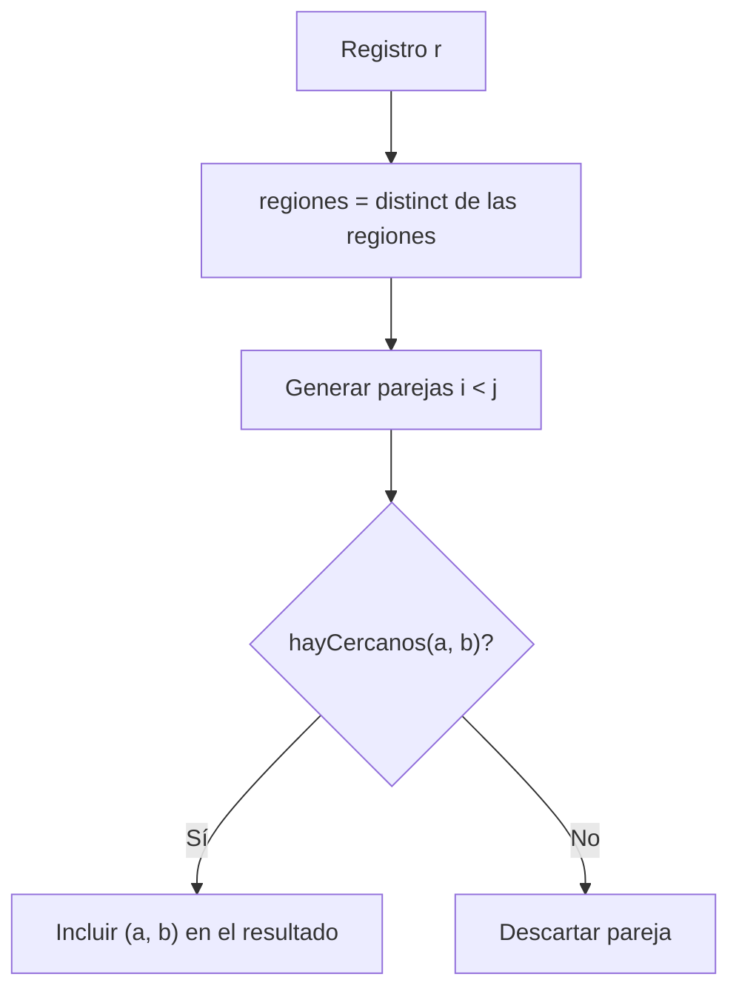
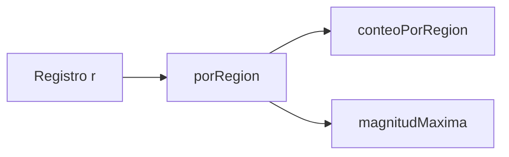
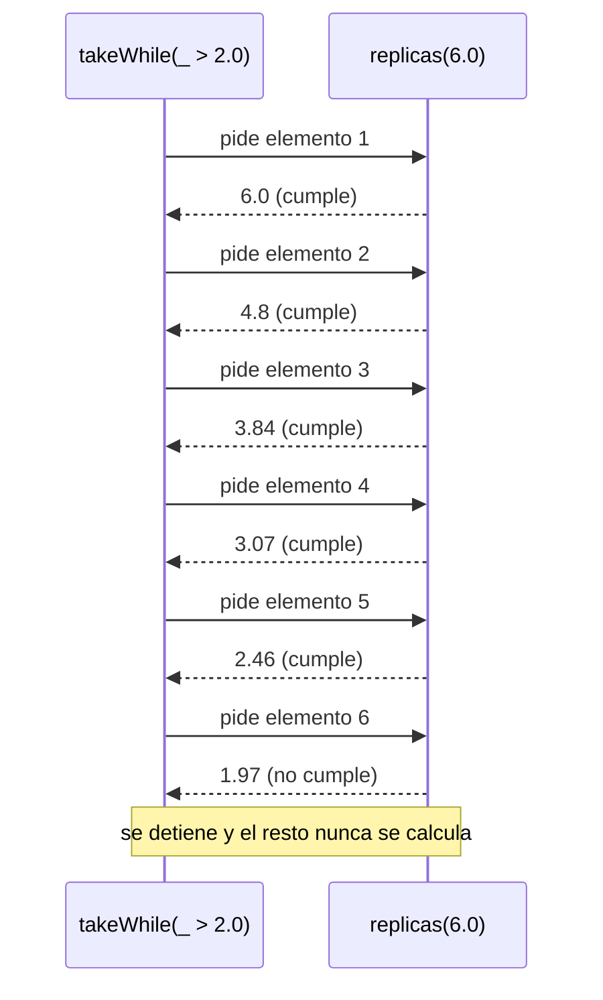
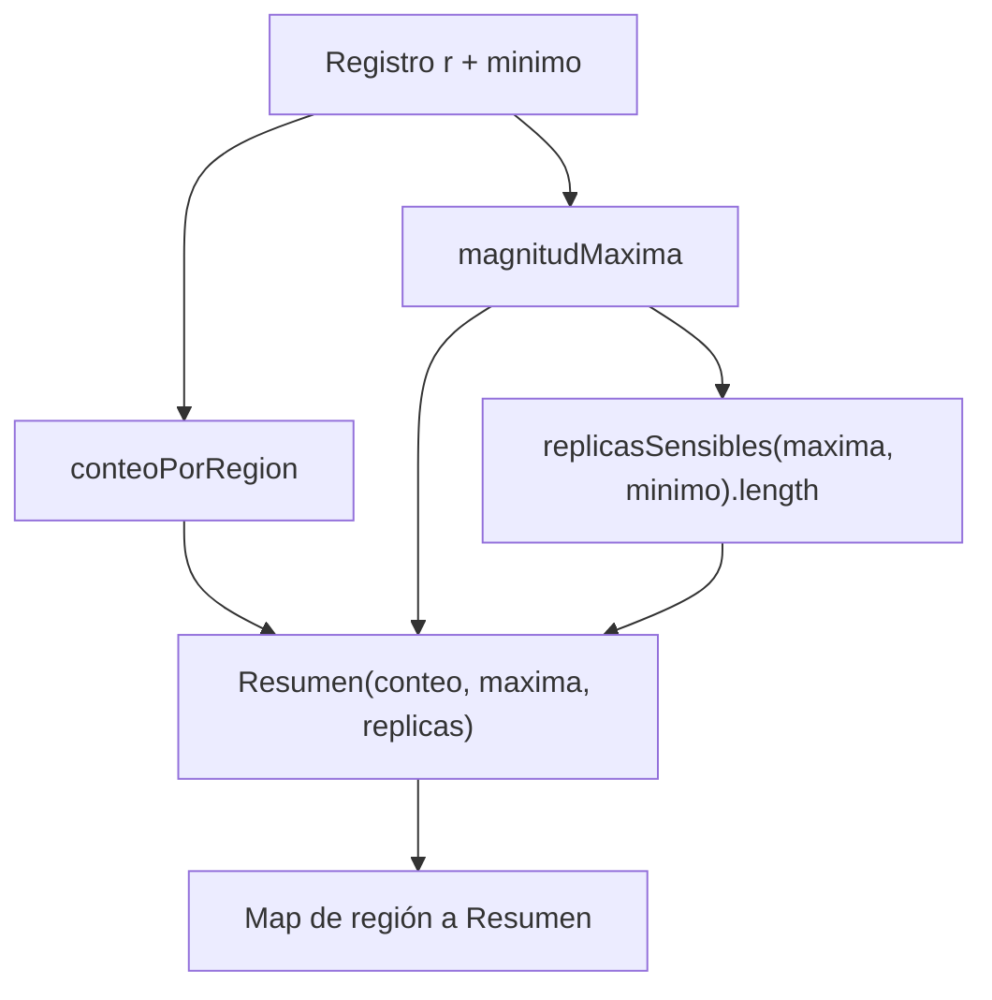

# Informe de Proceso: Análisis de Registros Sísmicos en Scala

## Contexto y modelo de datos

El taller trabaja sobre un **registro de sismos**. Cada sismo tiene una región y una magnitud, y el registro completo es una lista:

## Punto 1: Consultas con expresiones `for`

### Definición

```Scala
def fuertes(r: Registro, umbral: Double): List[String] =
  for { s <- r if s.magnitud > umbral } yield s.region
 
def enRegion(r: Registro, region: String): List[Double] =
  for { s <- r if s.region == region } yield s.magnitud
```

* `fuertes` devuelve las regiones de los sismos cuya magnitud **supera** el umbral, en orden y **con repetidos**.
* `enRegion` devuelve las magnitudes registradas en una región concreta.
* La expresión `for ... yield` combina tres operaciones: **recorrer** (`s <- r`), **filtrar** (`if ...`) y **transformar** (`yield ...`). Internamente Scala la traduce a `withFilter` y `map`.
### Explicación paso a paso

`fuertes(r, 5.0)`:

| Sismo | Condición `magnitud > 5.0` | ¿Pasa? | Aporta |
|-------|----------------------------|--------|--------|
| Norte 5.0  | 5.0 > 5.0 | No | — |
| Sur 6.5    | 6.5 > 5.0 | Sí | `"Sur"` |
| Norte 7.0  | 7.0 > 5.0 | Sí | `"Norte"` |
| Centro 4.0 | 4.0 > 5.0 | No | — |
| Sur 5.5    | 5.5 > 5.0 | Sí | `"Sur"` |

```Scala
fuertes(r, 5.0)        // List("Sur", "Norte", "Sur")
enRegion(r, "Norte")   // List(5.0, 7.0)
```

### `paresCercanos`

```Scala
def paresCercanos(r: Registro, dif: Double): List[(String, String)] = {
  val regiones = (for (s <- r) yield s.region).distinct
  def hayCercanos(a: String, b: String): Boolean =
    !(for {
      x <- r if x.region == a
      y <- r if y.region == b
      if Math.abs(x.magnitud - y.magnitud) <= dif
    } yield true).isEmpty
  (for {
    i <- 0 until regiones.length
    j <- (i + 1) until regiones.length
    if hayCercanos(regiones(i), regiones(j))
  } yield (regiones(i), regiones(j))).toList
}
```

El proceso tiene tres etapas:

1. **Regiones únicas**: se extraen las regiones y se eliminan repetidas con `distinct`. Resultado: `Norte, Sur, Centro`.
2. **Generar parejas sin repetir**: con `j` empezando en `i + 1` se obtiene cada pareja una sola vez y nunca una región consigo misma.
3. **Comprobar cercanía**: `hayCercanos(a, b)` compara **todos** los sismos de `a` contra **todos** los de `b` (generadores anidados). Si existe al menos una diferencia `<= dif`, el `for` produce algún `true` y la lista no queda vacía.
   Traza con `dif = 0.5`:

| Pareja | Comparación decisiva | ¿Cercanos? |
|--------|----------------------|------------|
| (Norte, Sur)    | \|5.0 − 5.5\| = 0.5 ≤ 0.5 | Sí |
| (Norte, Centro) | menor diferencia: \|5.0 − 4.0\| = 1.0 | No |
| (Sur, Centro)   | menor diferencia: \|5.5 − 4.0\| = 1.5 | No |

```Scala
paresCercanos(r, 0.5)  // List(("Norte", "Sur"))
```


 
---

## Punto 2: Agrupar con map

### Definición

```Scala
def porRegion(r: Registro): Map[String, List[Sismo]] =
  (for (s <- r)
  yield (s.region, for (t <- r if t.region == s.region) yield t)).toMap
 
def conteoPorRegion(r: Registro): Map[String, Int] =
  porRegion(r).map { case (reg, ss) => (reg, ss.length) }
 
def magnitudMaxima(r: Registro): Map[String, Double] =
  porRegion(r).map { case (reg, ss) => (reg, (for (s <- ss) yield s.magnitud).max) }
```

* `porRegion` construye, para **cada sismo**, una pareja `(región, todos los sismos de esa región)`. Como `toMap` conserva una sola entrada por clave, las parejas repetidas colapsan en una.
* `conteoPorRegion` y `magnitudMaxima` **reutilizan** `porRegion` y transforman cada valor: uno con `length`, el otro extrayendo las magnitudes y tomando el `max`.
### Explicación paso a paso

```Scala
porRegion(r)
// Map(
//   "Norte"  -> List(Sismo("Norte", 5.0), Sismo("Norte", 7.0)),
//   "Sur"    -> List(Sismo("Sur", 6.5),   Sismo("Sur", 5.5)),
//   "Centro" -> List(Sismo("Centro", 4.0))
// )
 
conteoPorRegion(r)   // Map("Norte" -> 2, "Sur" -> 2, "Centro" -> 1)
magnitudMaxima(r)    // Map("Norte" -> 7.0, "Sur" -> 6.5, "Centro" -> 4.0)
```


 
---

## Punto 3: Consultas seguras

El problema: consultar una clave inexistente en un `Map` lanza una excepción. Este punto muestra dos formas de evitarlo.

### Definición

```Scala
def conteoSeguro(r: Registro): Map[String, Int] =
  conteoPorRegion(r).withDefaultValue(0)
 
def maximaDe(r: Registro, region: String): Option[Double] =
  magnitudMaxima(r).get(region)
 
def regionMasActiva(r: Registro): Option[String] = {
  val conteo = conteoPorRegion(r)
  if (conteo.isEmpty) None
  else Some(conteo.reduce((a, b) =>
    if (a._2 > b._2 || (a._2 == b._2 && a._1 < b._1)) a else b)._1)
}
```

* `conteoSeguro` usa **valor por defecto**: las regiones ausentes responden `0` en lugar de fallar.
* `maximaDe` usa `Option`: `Some(valor)` si la región existe y `None` si no. La ausencia queda expresada en el tipo.
* `regionMasActiva` usa `reduce` para quedarse con la entrada de mayor conteo. En caso de **empate**, gana la región que va primero alfabéticamente (`a._1 < b._1`). Si el registro está vacío devuelve `None`.
### Explicación paso a paso

```Scala
conteoSeguro(r)("Norte")   // 2
conteoSeguro(r)("Oeste")   // 0  (sin error)
 
maximaDe(r, "Norte")       // Some(7.0)
maximaDe(r, "Oeste")       // None
```

Traza de `regionMasActiva(r)` con `conteo = Map(Norte -> 2, Sur -> 2, Centro -> 1)`:

| Paso | `a` | `b` | Decisión | Se queda |
|------|-----|-----|----------|----------|
| 1 | (Norte, 2) | (Sur, 2)    | empate y "Norte" < "Sur" | (Norte, 2) |
| 2 | (Norte, 2) | (Centro, 1) | 2 > 1 | (Norte, 2) |

```Scala
regionMasActiva(r)   // Some("Norte")
```
 
---

## Punto 4: Réplicas perezosas

### Definición

```Scala
def redondear(x: Double): Double = Math.round(x * 100.0) / 100.0
 
def replicas(magnitud: Double): LazyList[Double] =
  redondear(magnitud) #:: replicas(magnitud * 0.8)
 
def replicasSensibles(magnitud: Double, minimo: Double): List[Double] =
  replicas(magnitud).takeWhile(_ > minimo).toList
```

* `redondear` deja el valor con dos decimales.
* `replicas` describe una secuencia **infinita**: la primera réplica es la magnitud redondeada y cada siguiente vale el 80 % de la anterior.
* `replicasSensibles` toma las réplicas **mientras superen el mínimo** y las convierte en lista.
### Por qué no hay desbordamiento de pila

Igual que la recursión de cola evita acumular llamadas en la pila, `#::` evita evaluar la llamada recursiva: el resto de la secuencia queda **pendiente** y solo se calcula cuando alguien lo pide. Por eso una definición recursiva sin caso base no se cicla: `takeWhile` pide elementos uno a uno y se detiene en el primero que no cumple.

### Explicación paso a paso

`replicasSensibles(6.0, 2.0)`:

| Elemento | Cálculo | Valor mostrado | ¿> 2.0? | Acción |
|----------|---------|----------------|---------|--------|
| 1 | 6.0 | 6.0 | Sí | se incluye |
| 2 | 6.0 × 0.8 = 4.8 | 4.8 | Sí | se incluye |
| 3 | 3.84 | 3.84 | Sí | se incluye |
| 4 | 3.072 | 3.07 | Sí | se incluye |
| 5 | 2.4576 | 2.46 | Sí | se incluye |
| 6 | 1.96608 | 1.97 | No | **se detiene** |

```Scala
replicasSensibles(6.0, 2.0)  // List(6.0, 4.8, 3.84, 3.07, 2.46)
```

> Nota: el factor 0.8 se aplica a la magnitud **sin redondear**; el redondeo solo afecta al valor que se muestra, así el error no se acumula.


 
---

## Punto 5: Informe combinado

### Definición

```Scala
def informe(r: Registro, minimo: Double): Map[String, Resumen] = {
  val conteos = conteoPorRegion(r)
  magnitudMaxima(r).map { case (reg, maxima) =>
    (reg, Resumen(conteos(reg), maxima, replicasSensibles(maxima, minimo).length))
  }
}
```

`informe` integra los puntos anteriores. Para cada región produce un `Resumen` con:

1. **Conteo** de sismos: viene del Punto 2 (`conteoPorRegion`).
2. **Magnitud máxima**: viene del Punto 2 (`magnitudMaxima`).
3. **Réplicas esperadas** del sismo más fuerte: viene del Punto 4 (`replicasSensibles`), de las que solo interesa la **cantidad** (`length`).
### Explicación paso a paso

`informe(r, 2.0)`:

| Región | Conteo | Máxima | Réplicas sensibles (> 2.0) | Cantidad |
|--------|--------|--------|----------------------------|----------|
| Norte  | 2 | 7.0 | 7.0, 5.6, 4.48, 3.58, 2.87, 2.29 | 6 |
| Sur    | 2 | 6.5 | 6.5, 5.2, 4.16, 3.33, 2.66, 2.13 | 6 |
| Centro | 1 | 4.0 | 4.0, 3.2, 2.56, 2.05 | 4 |

```Scala
informe(r, 2.0)
// Map(
//   "Norte"  -> Resumen(2, 7.0, 6),
//   "Sur"    -> Resumen(2, 6.5, 6),
//   "Centro" -> Resumen(1, 4.0, 4)
// )
```


 
---

## Conclusiones

* Las expresiones `for` permiten **consultar** el registro con un estilo declarativo (recorrer, filtrar y transformar).
* Los **mapas** agrupan la información por región y se reutilizan como base de otras consultas.
* `withDefaultValue` y `Option` hacen que las consultas sean **seguras** frente a claves inexistentes.
* Las `LazyList` permiten modelar secuencias infinitas calculando **solo lo necesario**, de forma análoga a cómo la recursión de cola evita llenar la pila.
* El **informe** demuestra la composición: funciones pequeñas y reutilizables que se combinan en un resultado más completo.
 